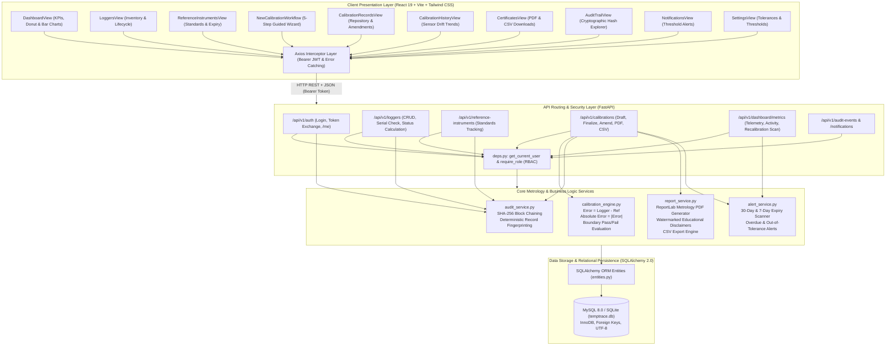
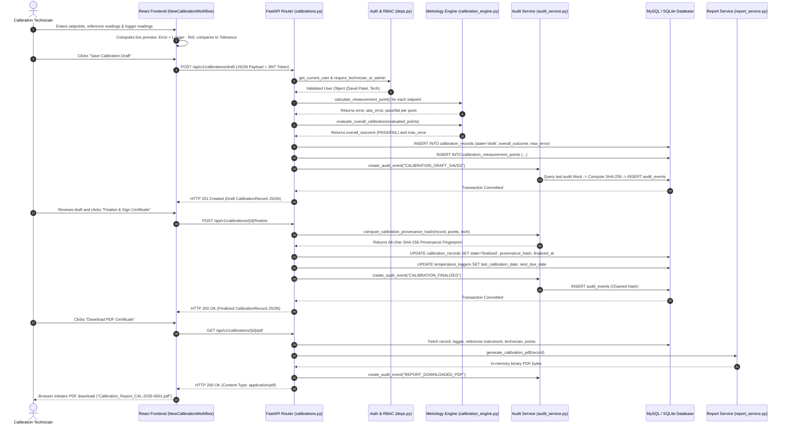
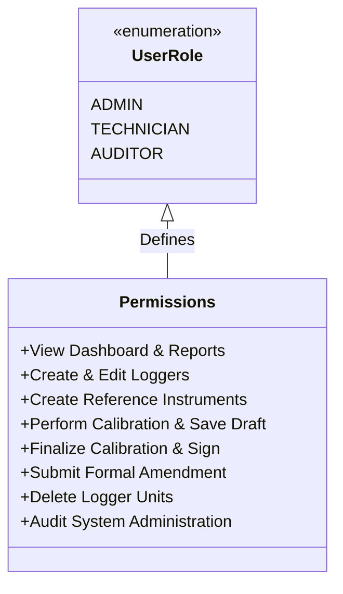

# TempTrace – Complete System Architecture Document

## 1. System Overview & Architectural Philosophy

**TempTrace** is a metrology-grade, full-stack laboratory calibration provenance and traceability management platform. It addresses the operational and regulatory need to track temperature data logger calibration lifecycles, verify measurement accuracy against calibrated laboratory standards, enforce strict acceptance limits, generate tamper-evident audit trails via cryptographic hash chaining, and export publication-ready calibration certificates in PDF and CSV formats.

The architecture strictly adheres to standard software engineering principles:
- **Separation of Concerns**: Decoupled React frontend (Single-Page Application), asynchronous FastAPI REST API backend, domain-specific metrology calculation engine, and relational persistence layer (MySQL / SQLite).
- **Defense in Depth**: JWT bearer token authentication, bcrypt password hashing, role-based access control (RBAC), parameter validation via Pydantic v2 schemas, and parameterized queries via SQLAlchemy 2.0 ORM.
- **Data Integrity & Traceability**: Append-only cryptographic hash chaining (SHA-256) for audit logging and deterministic record fingerprinting.
- **Fail-Safe Metrology Logic**: Deterministic floating-point error evaluation with four-decimal precision rounding to avoid IEEE 754 rounding artifacts.

---

## 2. End-to-End System Architecture Diagram



---

## 3. Frontend Architecture

### 3.1 Technology Stack & Tooling
- **Core Library**: React 19 (`react`, `react-dom`) using functional components and React Hooks (`useState`, `useEffect`, `useContext`, `useMemo`).
- **Build System**: Vite 8 with TypeScript (`@vitejs/plugin-react`) delivering instant HMR (Hot Module Replacement) and optimized tree-shaken static production bundles.
- **Styling**: Tailwind CSS v4 utilizing Utility-First classes for responsive, modern, laboratory-grade UI aesthetics with high contrast and dark mode neutral slates.
- **Data Visualizations**: Recharts (`ResponsiveContainer`, `BarChart`, `PieChart`, `LineChart`, `Cell`, `Tooltip`, `Legend`, `ReferenceLine`).
- **Icons**: Lucide React (`ShieldCheck`, `Scale`, `Activity`, `Clock`, `AlertTriangle`, `CheckCircle2`, `XCircle`, `FileText`, `Download`).
- **HTTP Client**: Axios configured with request/response interceptors.

### 3.2 State Management & Authentication Flow
State management is organized hierarchically:
1. **Global Auth State (`AuthContext.tsx`)**:
   - Manages `token` (JWT string) and `user` profile (`id`, `username`, `email`, `full_name`, `role`).
   - Persists credentials in `localStorage` under keys `temptrace_token` and `temptrace_user`.
   - Exposes `login()`, `logout()`, and `isAuthenticated` boolean flag.
   - Listens to global window custom event `auth_logout` dispatched by Axios interceptors upon receiving HTTP 401 responses.
2. **Local Component State**:
   - Manages table pagination, search query strings, modal view visibility, multi-step wizard state, form inputs, and inline calculation feedback.
3. **API Interceptor Architecture (`services/api.ts`)**:
   - Outgoing requests automatically inject `Authorization: Bearer <token>`.
   - Incoming responses intercept 401 Unauthorized status, clear cached credentials, and trigger seamless redirection to the authentication modal.

### 3.3 Component Hierarchy & Navigation
The application employs a Single-Page Application (SPA) layout controlled via conditional tab rendering in [App.tsx](file:///d:/3rd%20year%20odd%20sem/SOA/soa%20hakton/frontend/src/App.tsx):
- `Sidebar.tsx`: Persistent collapsible navigation drawer showing navigation items, live unread badge count, and user persona sign-out.
- Dynamic Main Viewport:
  - `DashboardView`: Operational metrology overview, KPI widgets, 6-month calibration verification bar chart, validity donut chart, upcoming recalibration schedule.
  - `LoggersView`: Fleet inventory grid, duplicate serial checking, status badges, calibration interval tracking, details drawer.
  - `ReferenceInstrumentsView`: Metrology reference standards, manufacturer certificates, stated uncertainties, expiry monitoring.
  - `NewCalibrationWorkflow`: 5-step interactive calibration wizard with real-time metrology error calculation.
  - `CalibrationRecordsView`: Historical calibration repository, certificate viewing, formal amendment authoring modal.
  - `CalibrationHistoryView`: Longitudinal sensor drift charts plotting error progression against ±tolerance boundaries over time.
  - `CertificatesView`: Formal certificate repository, direct PDF download, raw data CSV export.
  - `AuditTrailView`: Cryptographic append-only hash chain inspector with SHA-256 block verification.
  - `NotificationsView`: Filterable alerts for overdue, due-soon, and failed calibrations.
  - `SettingsView`: User profile inspection, acceptance limit defaults, and alert threshold configuration.

---

## 4. Backend Architecture

### 4.1 Framework & Core Modules
- **Framework**: FastAPI on Python 3.13 utilizing Starlette for ASGI routing and Pydantic v2 for JSON serialization and schema validation.
- **ASGI Server**: Uvicorn running with asynchronous event loops.
- **ORM & Database Abstraction**: SQLAlchemy 2.0 Declarative ORM supporting dialect swapping between SQLite (`sqlite:///./temptrace.db`) and MySQL 8.0 (`mysql+pymysql://...`).
- **Password Security**: Passlib with Bcrypt algorithm (`pwd_context = CryptContext(schemes=["bcrypt"], deprecated="auto")`).
- **Token Security**: Python-Jose generating signed JWTs with HMAC-SHA256 (`HS256`) algorithms.

### 4.2 Layered Directory Layout
```
backend/
├── app/
│   ├── api/
│   │   ├── api.py                    # Top-level API router aggregation
│   │   ├── deps.py                   # Dependency injection (Auth, Roles, DB Session)
│   │   └── endpoints/
│   │       ├── auth.py               # Authentication & identity endpoints
│   │       ├── loggers.py            # Logger fleet CRUD & status evaluation
│   │       ├── reference_instruments.py # Reference standards management
│   │       ├── calibrations.py       # Calibration lifecycle & amendment endpoints
│   │       ├── dashboard.py          # Dashboard KPIs & timeline aggregations
│   │       └── audit_and_alerts.py   # Cryptographic audit events & notifications
│   ├── core/
│   │   ├── config.py                 # Pydantic BaseSettings configuration
│   │   ├── database.py               # Engine creation & SessionLocal generator
│   │   └── security.py               # Password hashing & JWT encoding/decoding
│   ├── models/
│   │   └── entities.py               # SQLAlchemy ORM entity definitions
│   ├── schemas/
│   │   └── all_schemas.py            # Pydantic request & response models
│   └── services/
│       ├── calibration_engine.py     # Deterministic metrology error calculation
│       ├── audit_service.py          # SHA-256 hash chaining & record fingerprinting
│       ├── alert_service.py          # Recalibration & expiry scanning logic
│       └── report_service.py         # ReportLab PDF & CSV generation engine
├── main.py                           # Application factory & CORS initialization
├── seed_data.py                      # Realistic laboratory demo data seeder
└── tests/
    ├── test_api_integration.py       # Full-flow endpoint integration tests
    └── test_calibration_engine.py    # Unit tests for metrology math & boundary conditions
```

---

## 5. End-to-End Data Flow Architecture

The following sequence illustrates the complete data flow across layers when a calibration is performed, calculated, validated, cryptographically fingerprinted, committed to the database, and downloaded as a PDF report:



---

## 6. Security & Role-Based Access Control (RBAC) Architecture

TempTrace enforces a three-tier RBAC security model:



| Permission Capability | Administrator (`admin`) | Calibration Technician (`tech`) | Quality Auditor (`auditor`) | Enforcement Mechanism |
| :--- | :---: | :---: | :---: | :--- |
| **View Dashboard, Records, Drift Charts, & PDF Certificates** | Yes | Yes | Yes | `get_current_user` (Active Bearer Token) |
| **Register & Update Temperature Loggers** | Yes | Yes | Read-Only | `require_technician_or_admin` |
| **Register & Update Reference Instruments** | Yes | Yes | Read-Only | `require_technician_or_admin` |
| **Create Calibration Drafts & Enter Measurements** | Yes | Yes | Read-Only | `require_technician_or_admin` |
| **Finalize Calibration Records & Generate Hash** | Yes | Yes | Read-Only | `require_technician_or_admin` |
| **Submit Formal Post-Finalization Amendments** | Yes | Yes | Read-Only | `require_technician_or_admin` |
| **Delete Temperature Loggers from Inventory** | Yes | No (403 Forbidden) | No (403 Forbidden) | `require_admin` |
| **Mark System Notifications as Read** | Yes | Yes | Yes | `get_current_user` |

---

## 7. Reliability, Scalability, and Metrology Traceability Boundaries

1. **Zero External Friction Configuration**:
   The backend defaults to a local self-contained SQLite instance (`temptrace.db`) if MySQL environment variables are not supplied, enabling immediate zero-configuration verification, automated grading, and unit testing without local database setup friction.
2. **Deterministic Rounding**:
   All floating-point error subtractions are rounded to 4 decimal places via Python's `round(..., 4)` and JavaScript's `Math.round(... * 10000) / 10000`, ensuring cross-platform calculation parity between client and server.
3. **Formal Metrology Disclaimer**:
   In strict accordance with quality governance standards, all PDF reports, UI footers, and certificate previews clearly state:
   > *"Educational & Demonstration Calibration Record: This calibration document is generated by TempTrace for demonstration, validation, and educational traceability tracking. It does not represent an ISO/IEC 17025 accredited certificate unless independently audited and authorized by an accredited calibration laboratory."*

