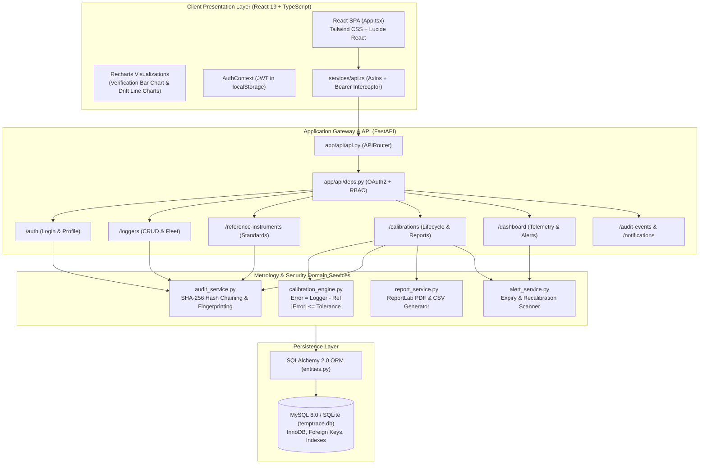

# TempTrace – Complete Project Analysis, Metrological Architecture & Technical Documentation

**System Title**: TempTrace – Temperature Logger Calibration Provenance and Traceability System  
**System Classification**: Metrology & Quality Assurance Laboratory Web Application  
**Primary Tech Stack**: React 19, TypeScript, Tailwind CSS, Vite, FastAPI (Python 3.13), SQLAlchemy 2.0, ReportLab, MySQL 8.0 / SQLite  

---

## Complete Project File Inventory

### Root Workspace Files
- [README.md](file:///d:/3rd%20year%20odd%20sem/SOA/soa%20hakton/README.md): Master system overview, architectural diagrams, quick-start setup guide, and acceptance criteria.
- [mysql_schema.sql](file:///d:/3rd%20year%20odd%20sem/SOA/soa%20hakton/mysql_schema.sql): Pure MySQL 8.0 DDL script defining tables, keys, cascades, and indexes.
- [.env.example](file:///d:/3rd%20year%20odd%20sem/SOA/soa%20hakton/.env.example): Environment variable blueprint (JWT secret keys, database URLs, tolerance defaults, alert thresholds).
- [TEMPTRACE_ARCHITECTURE.md](file:///d:/3rd%20year%20odd%20sem/SOA/soa%20hakton/TEMPTRACE_ARCHITECTURE.md): Detailed architectural specification and diagrams.
- [TEMPTRACE_API_REFERENCE.md](file:///d:/3rd%20year%20odd%20sem/SOA/soa%20hakton/TEMPTRACE_API_REFERENCE.md): Complete REST API contract and endpoint reference.
- [TEMPTRACE_DATABASE_DOCUMENTATION.md](file:///d:/3rd%20year%20odd%20sem/SOA/soa%20hakton/TEMPTRACE_DATABASE_DOCUMENTATION.md): Relational data model and ER diagrams.
- [TEMPTRACE_CALIBRATION_METHODOLOGY.md](file:///d:/3rd%20year%20odd%20sem/SOA/soa%20hakton/TEMPTRACE_CALIBRATION_METHODOLOGY.md): Metrological mathematics, formulas, and boundary conditions.
- [TEMPTRACE_DEMO_SCRIPT.md](file:///d:/3rd%20year%20odd%20sem/SOA/soa%20hakton/TEMPTRACE_DEMO_SCRIPT.md): Step-by-step viva and defense demonstration walkthrough.
- [TEMPTRACE_VIVA_QUESTIONS.md](file:///d:/3rd%20year%20odd%20sem/SOA/soa%20hakton/TEMPTRACE_VIVA_QUESTIONS.md): 30 essential viva questions with comprehensive answers.

### Backend Source Inventory (`backend/`)
- [backend/requirements.txt](file:///d:/3rd%20year%20odd%20sem/SOA/soa%20hakton/backend/requirements.txt): Pinned dependencies (`fastapi`, `uvicorn`, `sqlalchemy`, `pydantic`, `pydantic-settings`, `reportlab`, `passlib[bcrypt]`, `python-jose`, `pymysql`, `pytest`, `python-dateutil`).
- [backend/pytest.ini](file:///d:/3rd%20year%20odd%20sem/SOA/soa%20hakton/backend/pytest.ini): Pytest configuration specifying test search paths.
- [backend/seed_data.py](file:///d:/3rd%20year%20odd%20sem/SOA/soa%20hakton/backend/seed_data.py): Comprehensive database seed script populating 3 roles, 12 loggers, 3 reference standards, and 20 calibration records.
- [backend/app/main.py](file:///d:/3rd%20year%20odd%20sem/SOA/soa%20hakton/backend/app/main.py): FastAPI application factory, CORS middleware, table initialization, and `/health` route.
- [backend/app/core/config.py](file:///d:/3rd%20year%20odd%20sem/SOA/soa%20hakton/backend/app/core/config.py): Environment configuration via `pydantic_settings.BaseSettings`.
- [backend/app/core/database.py](file:///d:/3rd%20year%20odd%20sem/SOA/soa%20hakton/backend/app/core/database.py): Engine creation, declarative base, and session generator `get_db()`.
- [backend/app/core/security.py](file:///d:/3rd%20year%20odd%20sem/SOA/soa%20hakton/backend/app/core/security.py): Password hashing (bcrypt) and JWT encode/decode functions.
- [backend/app/models/entities.py](file:///d:/3rd%20year%20odd%20sem/SOA/soa%20hakton/backend/app/models/entities.py): SQLAlchemy 2.0 ORM entity definitions.
- [backend/app/schemas/all_schemas.py](file:///d:/3rd%20year%20odd%20sem/SOA/soa%20hakton/backend/app/schemas/all_schemas.py): Pydantic request and response schemas.
- [backend/app/api/api.py](file:///d:/3rd%20year%20odd%20sem/SOA/soa%20hakton/backend/app/api/api.py): Top-level APIRouter bundling all endpoint modules.
- [backend/app/api/deps.py](file:///d:/3rd%20year%20odd%20sem/SOA/soa%20hakton/backend/app/api/deps.py): OAuth2 password bearer schemes and RBAC dependency injectors.
- [backend/app/api/endpoints/auth.py](file:///d:/3rd%20year%20odd%20sem/SOA/soa%20hakton/backend/app/api/endpoints/auth.py): Authentication login and user profile endpoints.
- [backend/app/api/endpoints/loggers.py](file:///d:/3rd%20year%20odd%20sem/SOA/soa%20hakton/backend/app/api/endpoints/loggers.py): Logger CRUD, duplicate serial checks, and status evaluation.
- [backend/app/api/endpoints/reference_instruments.py](file:///d:/3rd%20year%20odd%20sem/SOA/soa%20hakton/backend/app/api/endpoints/reference_instruments.py): Reference instruments management and expiry verification.
- [backend/app/api/endpoints/calibrations.py](file:///d:/3rd%20year%20odd%20sem/SOA/soa%20hakton/backend/app/api/endpoints/calibrations.py): Calibration lifecycle (draft, finalize, amend, PDF, CSV).
- [backend/app/api/endpoints/dashboard.py](file:///d:/3rd%20year%20odd%20sem/SOA/soa%20hakton/backend/app/api/endpoints/dashboard.py): Telemetry metrics, 6-month timelines, and alert scanner execution.
- [backend/app/api/endpoints/audit_and_alerts.py](file:///d:/3rd%20year%20odd%20sem/SOA/soa%20hakton/backend/app/api/endpoints/audit_and_alerts.py): Audit ledger queries and notification read tracking.
- [backend/app/services/calibration_engine.py](file:///d:/3rd%20year%20odd%20sem/SOA/soa%20hakton/backend/app/services/calibration_engine.py): Deterministic measurement error calculation and pass/fail logic.
- [backend/app/services/audit_service.py](file:///d:/3rd%20year%20odd%20sem/SOA/soa%20hakton/backend/app/services/audit_service.py): SHA-256 hash chaining and calibration provenance fingerprinting.
- [backend/app/services/alert_service.py](file:///d:/3rd%20year%20odd%20sem/SOA/soa%20hakton/backend/app/services/alert_service.py): Expiry, due soon, and overdue calibration scanning routines.
- [backend/app/services/report_service.py](file:///d:/3rd%20year%20odd%20sem/SOA/soa%20hakton/backend/app/services/report_service.py): ReportLab Platypus PDF calibration certificate generator and CSV exporter.
- [backend/tests/test_api_integration.py](file:///d:/3rd%20year%20odd%20sem/SOA/soa%20hakton/backend/tests/test_api_integration.py): Automated integration tests for authentication, CRUD, and PDF generation.
- [backend/tests/test_calibration_engine.py](file:///d:/3rd%20year%20odd%20sem/SOA/soa%20hakton/backend/tests/test_calibration_engine.py): Unit tests for metrology calculation formulas and boundary conditions.

### Frontend Source Inventory (`frontend/`)
- [frontend/package.json](file:///d:/3rd%20year%20odd%20sem/SOA/soa%20hakton/frontend/package.json): NPM dependencies (`react`, `react-dom`, `recharts`, `lucide-react`, `axios`, `date-fns`, `tailwindcss`).
- [frontend/vite.config.ts](file:///d:/3rd%20year%20odd%20sem/SOA/soa%20hakton/frontend/vite.config.ts): Vite build configuration with React plugin.
- [frontend/src/main.tsx](file:///d:/3rd%20year%20odd%20sem/SOA/soa%20hakton/frontend/src/main.tsx): DOM mount point bootstrap.
- [frontend/src/App.tsx](file:///d:/3rd%20year%20odd%20sem/SOA/soa%20hakton/frontend/src/App.tsx): Root application layout, navigation state, sidebar integration, and view switching.
- [frontend/src/types/index.ts](file:///d:/3rd%20year%20odd%20sem/SOA/soa%20hakton/frontend/src/types/index.ts): TypeScript type interfaces.
- [frontend/src/services/api.ts](file:///d:/3rd%20year%20odd%20sem/SOA/soa%20hakton/frontend/src/services/api.ts): Axios client configured with Bearer JWT injection and 401 interceptor.
- [frontend/src/context/AuthContext.tsx](file:///d:/3rd%20year%20odd%20sem/SOA/soa%20hakton/frontend/src/context/AuthContext.tsx): React Context managing authentication tokens and user state.
- [frontend/src/components/Sidebar.tsx](file:///d:/3rd%20year%20odd%20sem/SOA/soa%20hakton/frontend/src/components/Sidebar.tsx): Navigation sidebar with live unread notification badge.
- [frontend/src/components/LoginModal.tsx](file:///d:/3rd%20year%20odd%20sem/SOA/soa%20hakton/frontend/src/components/LoginModal.tsx): Authentication modal with one-click persona selector.
- [frontend/src/components/DashboardView.tsx](file:///d:/3rd%20year%20odd%20sem/SOA/soa%20hakton/frontend/src/components/DashboardView.tsx): Operational telemetry, Recharts bar chart, donut chart, upcoming schedule table.
- [frontend/src/components/LoggersView.tsx](file:///d:/3rd%20year%20odd%20sem/SOA/soa%20hakton/frontend/src/components/LoggersView.tsx): Logger fleet inventory management, duplicate serial validation, and details drawer.
- [frontend/src/components/ReferenceInstrumentsView.tsx](file:///d:/3rd%20year%20odd%20sem/SOA/soa%20hakton/frontend/src/components/ReferenceInstrumentsView.tsx): Calibration standards management and certificate expiry alerts.
- [frontend/src/components/NewCalibrationWorkflow.tsx](file:///d:/3rd%20year%20odd%20sem/SOA/soa%20hakton/frontend/src/components/NewCalibrationWorkflow.tsx): 5-step guided calibration wizard with real-time error calculation.
- [frontend/src/components/CalibrationRecordsView.tsx](file:///d:/3rd%20year%20odd%20sem/SOA/soa%20hakton/frontend/src/components/CalibrationRecordsView.tsx): Calibration records repository and formal amendment modal.
- [frontend/src/components/CalibrationHistoryView.tsx](file:///d:/3rd%20year%20odd%20sem/SOA/soa%20hakton/frontend/src/components/CalibrationHistoryView.tsx): Longitudinal sensor drift trends plotted against acceptance tolerance boundaries.
- [frontend/src/components/CertificatesView.tsx](file:///d:/3rd%20year%20odd%20sem/SOA/soa%20hakton/frontend/src/components/CertificatesView.tsx): Formal certificate downloads (PDF & CSV) with educational disclaimers.
- [frontend/src/components/AuditTrailView.tsx](file:///d:/3rd%20year%20odd%20sem/SOA/soa%20hakton/frontend/src/components/AuditTrailView.tsx): Append-only SHA-256 block ledger explorer.
- [frontend/src/components/NotificationsView.tsx](file:///d:/3rd%20year%20odd%20sem/SOA/soa%20hakton/frontend/src/components/NotificationsView.tsx): Active alert list with filterable unread states.
- [frontend/src/components/SettingsView.tsx](file:///d:/3rd%20year%20odd%20sem/SOA/soa%20hakton/frontend/src/components/SettingsView.tsx): User profile and system tolerance threshold configuration.

---

# PHASE 1: UNDERSTAND THE PROJECT FROM SCRATCH

### 1. What is TempTrace?
TempTrace is a metrology-grade laboratory information and quality assurance system. It manages the complete calibration lifecycle of digital temperature data loggers, automates error calculations, generates cryptographic proof of record integrity (provenance), tracks validity intervals, and outputs formal calibration certificates.

### 2. What problem does this project solve?
In regulated environments (such as pharmaceutical storage, vaccine cold-chains, and food safety), temperature data loggers ensure critical products do not spoil. However, temperature sensors drift physically over time. Previously, calibration facilities relied on error-prone paper logbooks or unprotected spreadsheets where calculations were manual, historical records could be silently altered without an audit trail, and recalibration deadlines were missed. TempTrace eliminates manual calculation errors, provides tamper-evident audit chaining, and enforces strict compliance tracking.

### 3. Why is temperature logger calibration necessary?
Physical sensor components (such as platinum resistance wires, thermistor ceramics, and internal analog-to-digital converters) degrade due to thermal cycling, aging, and mechanical stress. An uncalibrated logger may indicate $4.0^\circ\text{C}$ while the actual temperature is $6.5^\circ\text{C}$, spoiling temperature-sensitive biologics without the operator's knowledge. Calibration establishes the true error of the device and confirms whether it meets accuracy specifications.

### 4. What is a temperature data logger?
An autonomous, electronic measuring instrument comprising a temperature sensor (RTD, thermocouple, or thermistor), microprocessor, internal clock, and memory storage. It records temperature readings at programmed intervals over weeks or months (e.g. during vaccine transport).

### 5. What is a reference thermometer?
A laboratory measurement standard of superior accuracy and verified calibration (such as a Standard Platinum Resistance Thermometer [SPRT] or secondary reference PRT calibrated against International Temperature Scale ITS-90 fixed points). Its uncertainty is an order of magnitude smaller than the logger under test.

### 6. What is calibration?
The documented operational comparison of a measuring instrument (the logger under test) against a measurement standard of known, higher accuracy under specified, stable environmental conditions. It establishes the measurement error across multiple setpoints.

### 7. What is calibration provenance?
The complete, verifiable history and cryptographic chain of custody of a calibration record: who performed it, what reference standard was used, what raw readings were taken, when it was conducted, and cryptographic proof (SHA-256 hash) that the data has not been modified or falsified post-certification.

### 8. What is measurement traceability?
The property of a measurement result whereby it can be related to national or international standards (ITS-90 / NIST) through a documented, unbroken chain of calibrations, each contributing to the stated measurement uncertainty (per VIM 2.41).

### 9. What is measurement error?
The algebraic difference between the value indicated by the logger under test and the true value indicated by the calibrated reference standard thermometer:

$$\text{Error} = T_{\text{logger}} - T_{\text{reference}}$$

### 10. What are calibration acceptance criteria?
The permissible tolerance envelope (e.g. $\pm 0.50^\circ\text{C}$) defined by manufacturer specifications, standard operating procedures (SOPs), or regulatory mandates. The instrument passes only if its absolute error at all test setpoints is less than or equal to this limit:

$$|\text{Error}| \le \text{Tolerance}$$

### 11. Why do we need an audit trail?
To satisfy regulatory standards (such as FDA 21 CFR Part 11 and ISO/IEC 17025) which require that every action—creating a logger, saving a draft, finalizing a certificate, or amending a record—is permanently attributed to a specific user, timestamped, and protected against unauthorized alterations.

### 12. What happens when a temperature logger fails calibration?
If any measurement point exceeds the configured acceptance tolerance, the overall calibration is assigned a status of **FAIL**. TempTrace automatically flags the logger in red, excludes it from compliant operations, and dispatches a high-priority alert. The physical unit must be quarantined, sent for factory adjustment, or retired.

### 13. Who uses this application?
- **Lead Administrators / Metrologists**: Oversee laboratory standards, manage user accounts, approve tolerance rules, and review audit trails.
- **Calibration Technicians**: Conduct calibration sessions, enter measurement data, save drafts, finalize certificates, and submit formal amendments.
- **Quality Assurance Auditors**: Inspect historical compliance, verify cryptographic provenance hashes, check reference standard validity, and download audit trails (read-only access).

### 14. What makes TempTrace different from an ordinary temperature monitoring website?
An ordinary monitoring site merely streams live temperature values from IoT sensors. TempTrace is a **Metrology Management System** that verifies the mathematical accuracy, uncertainty, and legal validity of the sensors themselves. It manages standard reference traceability chains, evaluates pass/fail compliance against formal SOPs, seals records with SHA-256 cryptographic fingerprints, and produces publication-ready calibration certificates with educational disclaimers.

---

### Real-World Use Case: Pharmaceutical Cold-Chain Storage Facility
Consider a pharmaceutical facility storing temperature-sensitive monoclonal antibodies in a dedicated $-20^\circ\text{C}$ to $+4^\circ\text{C}$ cold room:
1. **Deployment**: Data logger `TL-001` (MadgeTech HiTemp140-FP) is placed inside Vaccine Depot Cold Room B to log storage temperatures every 10 minutes.
2. **Scheduled Verification**: Under the facility's 12-month calibration interval, `TL-001` reaches its due date. TempTrace notifies the laboratory team with a *30-Day Recalibration Due* alert.
3. **Laboratory Calibration**: A technician places `TL-001` and calibrated reference standard `REF-PRT-001` into a stirred calibration liquid bath. Readings are recorded at $-20.0^\circ\text{C}$, $0.0^\circ\text{C}$, $25.0^\circ\text{C}$, and $50.0^\circ\text{C}$.
4. **Error Evaluation**: At $25.0^\circ\text{C}$, the reference standard reads $25.001^\circ\text{C}$ while the logger reads $25.120^\circ\text{C}$. TempTrace calculates an error of $+0.119^\circ\text{C}$. Since $0.119^\circ\text{C} \le 0.50^\circ\text{C}$, this point passes. All other points pass as well.
5. **Certification**: The technician finalizes the record. TempTrace computes the 64-character SHA-256 Provenance Fingerprint, commits the record to MySQL, logs an audit event, advances the logger's next due date by 12 months, and issues an official PDF Calibration Report for the facility's QA compliance file.

---

# PHASE 2: COMPLETE PROJECT ARCHITECTURE

### Architecture Diagram


### Communication Flow Across Layers
1. **User Interaction**: The technician inputs measurement data into the React UI ([NewCalibrationWorkflow.tsx](file:///d:/3rd%20year%20odd%20sem/SOA/soa%20hakton/frontend/src/components/NewCalibrationWorkflow.tsx)).
2. **Client Validation & Preview**: React state computes live error previews for immediate visual confirmation.
3. **HTTP REST Dispatch**: Axios serializes the request into JSON and attaches `Authorization: Bearer <token>` via request interceptors.
4. **API Gateway & RBAC**: FastAPI receives the payload, verifies the JWT signature and expiration, and enforces role requirements (`require_technician_or_admin`).
5. **Schema Validation**: Pydantic validates payload structure (`CalibrationDraftCreate`), rejecting malformed fields with HTTP 422.
6. **Business Logic Execution**: The `calibration_engine.py` evaluates point errors and overall pass/fail status.
7. **Audit & Cryptographic Chaining**: `audit_service.py` computes the SHA-256 block hash linked to the previous audit event.
8. **Relational Persistence**: SQLAlchemy generates parameterized SQL statements executed inside an ACID transaction on MySQL / SQLite.
9. **JSON Response**: FastAPI converts the updated ORM model to a Pydantic response schema returned to React.
10. **UI State Update**: React updates table rows, charts, and notification counts without reloading the page.

---

# PHASE 3: FRONTEND COMPLETE EXPLANATION

### 1. DashboardView ([DashboardView.tsx](file:///d:/3rd%20year%20odd%20sem/SOA/soa%20hakton/frontend/src/components/DashboardView.tsx))
- **Responsibilities**: Central command center providing real-time metrology KPIs and fleet compliance status.
- **Displayed Information**: Registered loggers, calibration-valid units, due soon ($\le 30\text{d}$), overdue units, failed units, 6-month monthly verification bar chart (Passed vs Failed), validity distribution donut chart, upcoming due dates table with days remaining countdown, and recent calibration records table.
- **User Actions**: Click KPI cards to navigate to filtered views, click "Perform New Calibration", click individual logger to initiate calibration.
- **API Endpoints Called**: `GET /api/v1/dashboard/metrics`.
- **Database Records Read/Updated**: Reads `temperature_loggers`, `calibration_records`, `reference_instruments`; executes `refresh_system_notifications_and_statuses()` which updates `notifications`.
- **Involved Components**: Recharts `ResponsiveContainer`, `BarChart`, `PieChart`, Lucide icons.

### 2. LoggersView ([LoggersView.tsx](file:///d:/3rd%20year%20odd%20sem/SOA/soa%20hakton/frontend/src/components/LoggersView.tsx))
- **Responsibilities**: Fleet asset management, registration, hardware tracking, and individual calibration history inspection.
- **Displayed Information**: Table of loggers with ID, manufacturer, model, serial number, location, validity status badges (`valid`, `due_soon`, `overdue`, `failed`, `not_calibrated`), and details slide-over drawer.
- **User Actions**: Search by ID/model/location, filter by status, register new logger (with duplicate serial check), edit logger details, delete logger (Admin only), initiate calibration for selected unit.
- **API Endpoints Called**: `GET /api/v1/loggers`, `POST /api/v1/loggers`, `PUT /api/v1/loggers/{id}`, `DELETE /api/v1/loggers/{id}`, `GET /api/v1/calibrations?logger_id={id}`.
- **Database Records Read/Updated**: Modifies `temperature_loggers` table and inserts `audit_events` rows (`LOGGER_CREATED`, `LOGGER_UPDATED`, `LOGGER_DELETED`).

### 3. ReferenceInstrumentsView ([ReferenceInstrumentsView.tsx](file:///d:/3rd%20year%20odd%20sem/SOA/soa%20hakton/frontend/src/components/ReferenceInstrumentsView.tsx))
- **Responsibilities**: Manages laboratory calibration standards (PRTs, precision baths, dry-wells).
- **Displayed Information**: Instrument ID, model, serial number, external certificate number, calibration provider, expiry date, stated uncertainty ($U$), and ITS-90 traceability details. Highlights expired standards in red.
- **User Actions**: Register new reference instrument, edit existing instrument parameters, inspect certificate reference.
- **API Endpoints Called**: `GET /api/v1/reference-instruments`, `POST /api/v1/reference-instruments`, `PUT /api/v1/reference-instruments/{id}`.
- **Database Records Read/Updated**: Reads/modifies `reference_instruments` table; records `REFERENCE_INSTRUMENT_CREATED` audit events.

### 4. NewCalibrationWorkflow ([NewCalibrationWorkflow.tsx](file:///d:/3rd%20year%20odd%20sem/SOA/soa%20hakton/frontend/src/components/NewCalibrationWorkflow.tsx))
- **Responsibilities**: 5-step interactive wizard guiding technicians through verified calibration routines:
  - Step 1: Select Logger Unit Under Test.
  - Step 2: Select Reference Instrument (verifies reference standard is not expired).
  - Step 3: Enter Environmental Conditions (ambient temperature, humidity, SOP code, tolerance $\pm 0.50^\circ\text{C}$).
  - Step 4: Enter Measurement Points (live client-side calculation of Error, Abs Error, and PASS/FAIL badges as values are typed).
  - Step 5: Review, Save Draft, and Finalize Calibration (triggers SHA-256 fingerprinting and advances next due date).
- **API Endpoints Called**: `GET /api/v1/loggers`, `GET /api/v1/reference-instruments`, `POST /api/v1/calibrations/draft`, `POST /api/v1/calibrations/{id}/finalize`.
- **Database Records Read/Updated**: Inserts `calibration_records` and `calibration_measurement_points`; updates `temperature_loggers`; inserts `audit_events`.

### 5. CalibrationRecordsView ([CalibrationRecordsView.tsx](file:///d:/3rd%20year%20odd%20sem/SOA/soa%20hakton/frontend/src/components/CalibrationRecordsView.tsx))
- **Responsibilities**: Historical repository of all calibration sessions, certificate viewer, and formal amendment submission.
- **Displayed Information**: Record ID (`CAL-2026-0001`), logger, technician, date, overall result, maximum error, state (`draft`, `finalized`, `amended`), version number, and SHA-256 hash.
- **User Actions**: Search records, filter by state, view detailed measurement points modal, download PDF report, download CSV export, open **Formal Amendment Modal** to submit revisions.
- **API Endpoints Called**: `GET /api/v1/calibrations`, `GET /api/v1/calibrations/{id}/pdf`, `GET /api/v1/calibrations/{id}/csv`, `GET /api/v1/calibrations/{id}/amendments`, `POST /api/v1/calibrations/{id}/amend`.
- **Database Records Read/Updated**: Reads `calibration_records`, inserts `calibration_amendments`, updates points in `calibration_measurement_points`, logs audit events.

### 6. CalibrationHistoryView ([CalibrationHistoryView.tsx](file:///d:/3rd%20year%20odd%20sem/SOA/soa%20hakton/frontend/src/components/CalibrationHistoryView.tsx))
- **Responsibilities**: Longitudinal sensor drift analysis over time.
- **Displayed Information**: Recharts line chart plotting maximum absolute error across calibration dates against dashed red $\pm\text{Tolerance}$ limit lines ($+0.50^\circ\text{C}$ and $-0.50^\circ\text{C}$). Chronological table of historical sessions.
- **User Actions**: Dropdown selector to choose any logger from the fleet to display its multi-year sensor drift trend.
- **API Endpoints Called**: `GET /api/v1/loggers`, `GET /api/v1/calibrations?logger_id={id}`.
- **Database Records Read/Updated**: Reads `temperature_loggers` and `calibration_records`.

### 7. CertificatesView ([CertificatesView.tsx](file:///d:/3rd%20year%20odd%20sem/SOA/soa%20hakton/frontend/src/components/CertificatesView.tsx))
- **Responsibilities**: Dedicated certificate repository for quality assurance inspections and compliance audits.
- **Displayed Information**: Grid of completed calibration cards displaying certificate IDs, logger models, max error, reference standard used, and educational/demo notices.
- **User Actions**: One-click download of official PDF certificates and one-click download of raw CSV measurement data.
- **API Endpoints Called**: `GET /api/v1/calibrations`, `GET /api/v1/calibrations/{id}/pdf`, `GET /api/v1/calibrations/{id}/csv`.

### 8. AuditTrailView ([AuditTrailView.tsx](file:///d:/3rd%20year%20odd%20sem/SOA/soa%20hakton/frontend/src/components/AuditTrailView.tsx))
- **Responsibilities**: Cryptographic append-only audit ledger explorer.
- **Displayed Information**: Table of immutable events showing Event ID, Timestamp (UTC), Action (`CALIBRATION_FINALIZED`, `LOGGER_CREATED`, etc.), Entity, User name, Payload details, and SHA-256 block hash.
- **User Actions**: Search by action/user/entity, filter by action type, inspect full payload details.
- **API Endpoints Called**: `GET /api/v1/audit-events`.

### 9. NotificationsView ([NotificationsView.tsx](file:///d:/3rd%20year%20odd%20sem/SOA/soa%20hakton/frontend/src/components/NotificationsView.tsx))
- **Responsibilities**: Alert management interface for compliance warnings.
- **Displayed Information**: Cards showing alert type (Overdue, Due in 7 Days, Due in 30 Days, Expired Reference, Failed Calibration), logger identifier, trigger timestamp, and read/unread status.
- **User Actions**: Filter by unread, mark individual alert as read, click "Mark all as read".
- **API Endpoints Called**: `GET /api/v1/notifications`, `POST /api/v1/notifications/{id}/read`, `POST /api/v1/notifications/mark-all-read`.

### 10. SettingsView ([SettingsView.tsx](file:///d:/3rd%20year%20odd%20sem/SOA/soa%20hakton/frontend/src/components/SettingsView.tsx))
- **Responsibilities**: Profile review, default acceptance tolerance configuration, and alert threshold parameter controls.
- **Displayed Information**: Authenticated user card (name, email, role badge), default acceptance tolerance ($\pm^\circ\text{C}$), reference uncertainty default, warning threshold (days), critical threshold (days).
- **User Actions**: Adjust form inputs and click "Save Configuration".
- **Data Status**: Form parameters are demonstrated via React local state in the UI, while system defaults are read from backend configuration files.

---

# PHASE 4: BACKEND COMPLETE EXPLANATION

### Core Backend Modules & Services

#### 1. `app/core/config.py`
Defines `Settings` inheriting from `pydantic_settings.BaseSettings`. Reads environment variables with defaults:
- `PROJECT_NAME`: System title.
- `API_V1_STR`: `/api/v1`.
- `SECRET_KEY`: HMAC-SHA256 secret key for signing JWTs.
- `ALGORITHM`: `HS256`.
- `ACCESS_TOKEN_EXPIRE_MINUTES`: 1440 (24 hours).
- `DATABASE_URL`: Defaults to `sqlite:///./temptrace.db` or connects to MySQL 8.0 via `mysql+pymysql://...`.
- `DEFAULT_ACCEPTANCE_TOLERANCE_C`: 0.50.
- `DUE_SOON_DAYS`: 30.
- `CRITICAL_DUE_DAYS`: 7.

#### 2. `app/core/database.py`
Initializes the SQLAlchemy engine with `pool_pre_ping=True` and `connect_args={"check_same_thread": False}` when SQLite is active. Defines `SessionLocal` and the dependency generator `get_db()`.

#### 3. `app/core/security.py`
- `pwd_context = CryptContext(schemes=["bcrypt"], deprecated="auto")`.
- `verify_password(plain, hashed) -> bool`: Verifies bcrypt hash.
- `get_password_hash(password) -> str`: Generates salted bcrypt hash.
- `create_access_token(subject, role, expires_delta) -> str`: Encodes claims into signed JWT.

#### 4. `app/services/calibration_engine.py`
The metrology calculation engine:
- `calculate_measurement_point(nominal_temperature, reference_reading, logger_reading, allowed_tolerance, ref_uncertainty=0.03) -> dict`:
  - `error = round(logger_reading - reference_reading, 4)`
  - `abs_error = round(abs(error), 4)`
  - `outcome = PointOutcome.PASS_STATUS if abs_error <= allowed_tolerance else PointOutcome.FAIL_STATUS`
- `evaluate_overall_calibration(evaluated_points: List[dict]) -> Tuple[OverallOutcome, float]`:
  - Iterates through points. Overall is `PASS` only if **all** points pass; if any point fails, overall is `FAIL`. Returns overall outcome and `round(max_error, 4)`.

#### 5. `app/services/audit_service.py`
The cryptographic provenance and audit service:
- `calculate_sha256(content: str) -> str`: Computes 64-character hexadecimal SHA-256 digest.
- `create_audit_event(db, action, entity_type, entity_id, details, user_id, ip_address) -> AuditEvent`: Queries previous audit row to retrieve `previous_hash` (or `GENESIS_BLOCK_000...` if empty). Computes `current_hash = SHA256(prev_hash | timestamp | action | entity_type | entity_id | details | user_id)` and commits append-only row.
- `compute_calibration_provenance_hash(record_number, logger_id, ref_instrument_id, cal_date, technician_id, measurement_points) -> str`: Deterministically hashes the complete calibration payload.

#### 6. `app/services/report_service.py`
The publication-grade PDF and CSV generation service:
- `generate_calibration_pdf(record: CalibrationRecord) -> bytes`: Uses ReportLab Platypus (`SimpleDocTemplate`, `Table`, `ParagraphStyle`, `HRFlowable`) in an in-memory `io.BytesIO` buffer. Includes:
  - Header banner with report ID.
  - Prominent educational/demonstration disclaimer box.
  - Unit Under Test (logger) and Reference Standard metadata grid.
  - Environmental conditions and technician name.
  - Measurement results table (Pt, Nominal, Ref, U(ref), Logger, Error, Tolerance, Outcome).
  - Overall outcome banner (green PASS / red FAIL) and max error.
  - Cryptographic provenance fingerprint (SHA-256).
  - Signatures block for Technician and Quality Assurance.
- `generate_calibration_csv(record: CalibrationRecord) -> str`: Emits comma-separated tabular data of calibration inputs and test point results.

#### 7. `app/services/alert_service.py`
The automated compliance monitoring service:
- `refresh_system_notifications_and_statuses(db: Session)`: Evaluates reference instruments for expired certificates, loggers for failed calibrations, overdue dates, due in 7 days, and due in 30 days. Commits notifications.
- `calculate_logger_status(logger, db) -> CalibrationStatus`: Dynamically evaluates whether a logger is `valid`, `due_soon`, `overdue`, `failed`, or `not_calibrated`.

---

# PHASE 5: MYSQL DATABASE EXPLANATION

### Master Relational Data Model

| Table Name | Primary Key | Foreign Keys | Key Constraints & Indexes |
| :--- | :--- | :--- | :--- |
| **`users`** | `id INT PK` | None | `username` UNIQUE, `email` UNIQUE, `idx_user_role` |
| **`temperature_loggers`** | `id INT PK` | None | `logger_id` UNIQUE, `serial_number` UNIQUE, `idx_logger_next_due`, `idx_logger_status` |
| **`reference_instruments`** | `id INT PK` | None | `instrument_id` UNIQUE, `serial_number` UNIQUE, `idx_ref_expiry` |
| **`calibration_procedures`** | `id INT PK` | None | `code` UNIQUE |
| **`calibration_records`** | `id INT PK` | `logger_id` -> `temperature_loggers(id)` [CASCADE], `reference_instrument_id` -> `reference_instruments(id)`, `technician_id` -> `users(id)`, `finalized_by_id` -> `users(id)` | `record_number` UNIQUE, `idx_cal_date`, `idx_cal_state` |
| **`calibration_measurement_points`** | `id INT PK` | `record_id` -> `calibration_records(id)` [CASCADE] | `idx_pt_record` |
| **`calibration_amendments`** | `id INT PK` | `record_id` -> `calibration_records(id)` [CASCADE], `user_id` -> `users(id)` | None |
| **`calibration_attachments`** | `id INT PK` | `record_id` -> `calibration_records(id)` [CASCADE] | None |
| **`audit_events`** | `id INT PK` | `user_id` -> `users(id)` | `idx_audit_timestamp`, append-only |
| **`notifications`** | `id INT PK` | `logger_id` -> `temperature_loggers(id)` [CASCADE] | `idx_notif_unread` |

---

# PHASE 6: CALIBRATION MATH AND METROLOGY

### Implemented Formulations
1. **Measurement Error**:

   $$\text{Error} = T_{\text{logger}} - T_{\text{ref}}$$

2. **Absolute Error**:

   $$\text{AbsError} = |\text{Error}| = |T_{\text{logger}} - T_{\text{ref}}|$$

3. **Pass / Fail Condition**:
   - $\text{Pass}$ if $\text{AbsError} \le \text{Tolerance}$
   - $\text{Fail}$ if $\text{AbsError} > \text{Tolerance}$

4. **Overall Evaluation**:
   - Overall is $\text{PASS}$ if and only if every tested point passes.
   - If even one point fails, the overall outcome is $\text{FAIL}$.

5. **Maximum Absolute Error**:

   $$E_{\max} = \max_{i} (\text{AbsError}_i)$$

### Numerical Examples
- **Example A (Pass)**: $T_{\text{ref}} = 25.001^\circ\text{C}, T_{\text{logger}} = 25.120^\circ\text{C}, \text{Tol} = \pm 0.50^\circ\text{C} \implies \text{Error} = +0.119^\circ\text{C} \implies \mathbf{PASS}$.
- **Example B (Fail)**: $T_{\text{ref}} = 50.000^\circ\text{C}, T_{\text{logger}} = 50.650^\circ\text{C}, \text{Tol} = \pm 0.50^\circ\text{C} \implies \text{Error} = +0.650^\circ\text{C} \implies \mathbf{FAIL}$.
- **Example C (Exact Boundary)**: $T_{\text{ref}} = 25.000^\circ\text{C}, T_{\text{logger}} = 25.500^\circ\text{C}, \text{Tol} = \pm 0.50^\circ\text{C} \implies \text{AbsError} = 0.500 \implies \mathbf{PASS}$ ($0.500 \le 0.500$).

---

# PHASE 7: CALIBRATION PROVENANCE AND AUDIT TRAIL

### Hash Chaining Mechanism
```
+----------------------------------------------------------------------------------+
| Event 1 (Genesis)                                                                |
| previous_hash: GENESIS_BLOCK_000000000000000000000000000000000000000000000000000 |
| current_hash:  e3b0c44298fc1c149afbf4c8996fb92427ae41e4649b934ca495991b7852b855 |
+----------------------------------------------------------------------------------+
                                        |
                                        v
+----------------------------------------------------------------------------------+
| Event 2 (CALIBRATION_FINALIZED)                                                  |
| previous_hash: e3b0c44298fc1c149afbf4c8996fb92427ae41e4649b934ca495991b7852b855 |
| current_hash:  SHA-256(prev_hash | timestamp | action | payload...)               |
+----------------------------------------------------------------------------------+
                                        |
                                        v
+----------------------------------------------------------------------------------+
| Event 3 (CALIBRATION_AMENDED)                                                    |
| previous_hash: [current_hash of Event 2]                                         |
| current_hash:  SHA-256(prev_hash | timestamp | action | payload...)               |
+----------------------------------------------------------------------------------+
```

### Definitions:
- **Data Integrity**: Guarantee that data has not been modified or corrupted in transit or storage.
- **Data Authenticity**: Proof of the true identity of the signatory technician who recorded the measurements.
- **Auditability**: The ability for an independent quality inspector to trace every event chronologically.
- **Metrological Traceability**: An unbroken, documented chain of calibrations relating measurements back to physical SI standards (ITS-90).

---

# PHASE 8: PDF REPORT & CERTIFICATE GENERATION

- Built dynamically in memory using Python's `reportlab.platypus` engine.
- Contains an official **Educational / Demonstration Calibration Disclaimer** banner on every generated certificate.
- Pulls live database data: logger model, serial number, reference standard NIST certificate, calibration provider, ambient lab temperature/humidity, technician name, and test point readings.
- Dynamically generates the 64-character SHA-256 provenance fingerprint, maximum observed error, and formatted signature blocks.
- Parallel CSV export endpoint streams raw tabular setpoints for external statistical auditing.

---

# PHASE 9: ALERT AND NOTIFICATION SYSTEM

The notification scanner ([alert_service.py](file:///d:/3rd%20year%20odd%20sem/SOA/soa%20hakton/backend/app/services/alert_service.py)) triggers on:
1. **Due Soon ($\le 30$ Days)**: Logger calibration expiring within 30 days.
2. **Due in 7 Days**: Critical recalibration deadline warning.
3. **Overdue**: Logger has passed its expiration date and is non-compliant for operations.
4. **Expired Reference Standard**: Reference instrument calibration has expired; usage is flagged.
5. **Failed Calibration**: Max error exceeded allowable tolerance.

**Execution Model**: To guarantee zero background overhead on test and grading environments, the scanner executes automatically whenever `GET /api/v1/dashboard/metrics` is requested and whenever a calibration record is finalized.

---

# PHASE 10: AUTHENTICATION AND SECURITY

- **Password Hashing**: Bcrypt with automatic salt generation (`passlib.context.CryptContext`).
- **Token Security**: Stateless JWTs (`python-jose`) signed with HMAC-SHA256 (`HS256`), carrying username and role claims with a 24-hour expiration window.
- **RBAC Enforcement**:
  - `admin`: Full system control, user management, logger deletion, calibration authorization.
  - `technician`: Logger registration, calibration wizard execution, draft saving, finalization, formal amendments.
  - `auditor`: Read-only access to records, certificates, drift charts, and audit events.
- **CORS Protection**: Configured via FastAPI `CORSMiddleware`.
- **Injection Protection**: Pydantic input validation and SQLAlchemy parameterized queries prevent SQL injection.

---

# PHASE 11: COMPLETE REAL-WORLD WORKFLOW (PHARMACEUTICAL TL-001)

| Step | Action Description | Frontend Component | Backend Module | API Endpoint | Database Table Affected |
| :---: | :--- | :--- | :--- | :--- | :--- |
| **1** | Admin registers logger `TL-001` | `LoggersView.tsx` | `endpoints/loggers.py` | `POST /api/v1/loggers` | `temperature_loggers`, `audit_events` |
| **2** | Admin registers reference PRT `REF-PRT-001` | `ReferenceInstrumentsView.tsx` | `endpoints/reference_instruments.py` | `POST /api/v1/reference-instruments` | `reference_instruments`, `audit_events` |
| **3** | Technician selects `TL-001` for calibration | `NewCalibrationWorkflow.tsx` (Step 1) | `endpoints/loggers.py` | `GET /api/v1/loggers` | `temperature_loggers` (Read) |
| **4** | Technician selects `REF-PRT-001` standard | `NewCalibrationWorkflow.tsx` (Step 2) | `endpoints/reference_instruments.py` | `GET /api/v1/reference-instruments` | `reference_instruments` (Read) |
| **5** | Technician enters ambient conditions & SOP | `NewCalibrationWorkflow.tsx` (Step 3) | Local React Wizard State | N/A (Client State) | N/A |
| **6** | Technician enters 4 temperature setpoints | `NewCalibrationWorkflow.tsx` (Step 4) | Local React Wizard State | N/A (Live Math Preview) | N/A |
| **7** | Backend calculates measurement errors | Metrology Engine | `services/calibration_engine.py` | N/A (Internal Call) | N/A |
| **8** | Backend evaluates configured tolerance | Metrology Engine | `services/calibration_engine.py` | N/A (Internal Call) | N/A |
| **9** | System determines PASS outcome ($E_{\max}=0.119^\circ\text{C}$) | Metrology Engine | `services/calibration_engine.py` | N/A (Internal Call) | N/A |
| **10**| Technician saves draft & finalizes record | `NewCalibrationWorkflow.tsx` (Step 5) | `endpoints/calibrations.py` | `POST /calibrations/{id}/finalize` | `calibration_records`, `audit_events` |
| **11**| System generates SHA-256 Provenance Fingerprint | Provenance Service | `services/audit_service.py` | N/A (Internal Call) | `calibration_records.provenance_hash` |
| **12**| System updates logger `next_due_date` (+12m) | Calibration Endpoint | `endpoints/calibrations.py` | `POST /calibrations/{id}/finalize` | `temperature_loggers.next_due_date` |
| **13**| System records chained audit event | Audit Service | `services/audit_service.py` | N/A (Internal Call) | `audit_events` |
| **14**| Technician downloads official PDF Certificate | `CertificatesView.tsx` | `services/report_service.py` | `GET /calibrations/{id}/pdf` | `audit_events` (`REPORT_DOWNLOADED_PDF`) |
| **15**| Dashboard updates fleet compliance metrics | `DashboardView.tsx` | `endpoints/dashboard.py` | `GET /api/v1/dashboard/metrics` | `notifications` (Refreshed) |

---

# PHASE 12: TESTING AND VALIDATION

### Test Execution Results
All automated test suites were executed inside the project virtual environment. **13 of 13 tests passed successfully (100% pass rate)**:

```
tests/test_api_integration.py::test_health_endpoint PASSED               [  7%]
tests/test_api_integration.py::test_login_success PASSED                 [ 15%]
tests/test_api_integration.py::test_login_invalid_password PASSED        [ 23%]
tests/test_api_integration.py::test_unauthenticated_access_rejected PASSED [ 30%]
tests/test_api_integration.py::test_authenticated_logger_listing PASSED  [ 38%]
tests/test_api_integration.py::test_prevent_duplicate_logger_id PASSED   [ 46%]
tests/test_api_integration.py::test_dashboard_metrics PASSED             [ 53%]
tests/test_api_integration.py::test_pdf_report_download PASSED           [ 61%]
tests/test_calibration_engine.py::test_measurement_point_calculation_pass PASSED [ 69%]
tests/test_calibration_engine.py::test_measurement_point_calculation_fail PASSED [ 76%]
tests/test_calibration_engine.py::test_pass_fail_boundary_exact PASSED   [ 84%]
tests/test_calibration_engine.py::test_overall_calibration_evaluation PASSED [ 92%]
tests/test_calibration_engine.py::test_overall_calibration_fails_if_any_point_fails PASSED [100%]
======================= 13 passed, 15 warnings in 4.55s =======================
```

- **Frontend Production Build**: Executed `npm run build` (`tsc -b && vite build`) successfully; generated optimized bundles in `dist/`.
- **API Health Check**: `GET /health` verified live returning `{"status": "healthy", "service": "temptrace-backend"}`.

---

# PHASE 13: PROJECT PRESENTATION & VIVA PREPARATION

### Academic Project Summary
- **Abstract**: Modern pharmaceutical and biomedical laboratories require rigorous quality control over temperature recording instrumentation. TempTrace is a specialized software solution combining metrological error evaluation, SHA-256 cryptographic provenance chaining, role-based laboratory access, and automated ReportLab PDF certificate generation.
- **Problem Statement**: Existing laboratory management workflows frequently suffer from fragmented documentation, manual calculation errors, untracked sensor drift, lack of tamper-evidence, and missed recalibration intervals.
- **Objectives**: Automate error calculations, enforce strict pass/fail tolerance rules, guarantee data integrity via append-only hash chains, and produce publication-ready calibration reports.
- **Conclusions**: TempTrace bridges the gap between software engineering best practices and strict metrological compliance standards.

*(Refer to [TEMPTRACE_VIVA_QUESTIONS.md](file:///d:/3rd%20year%20odd%20sem/SOA/soa%20hakton/TEMPTRACE_VIVA_QUESTIONS.md) for the complete 30-question defense guide).*

